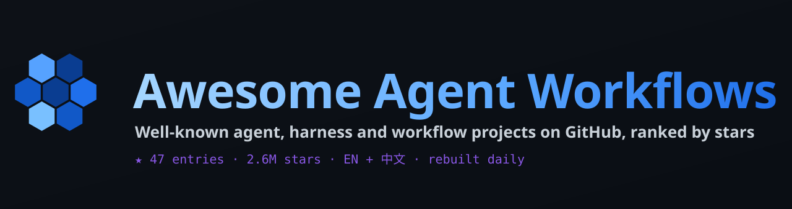
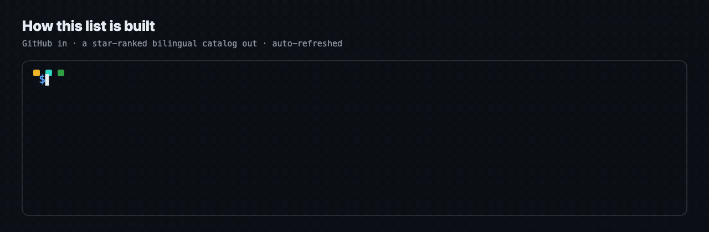

# Awesome Agent Workflows

<i>Well-known agent, harness and workflow projects on GitHub, ranked by stars</i>

  

  

**English** · [简体中文](README.zh-CN.md)

 judge -> rank by stars -> render EN + 中文 -> auto-refresh"/>

---

## Contents

- [🏆 Top Picks](#top-picks)
- [Agent Frameworks](#sec-1) · 12
- [Coding Agents & Harnesses](#sec-2) · 12
- [Workflow Platforms](#sec-3) · 12
- [Patterns & Guides](#sec-4) · 11
- [📖 About this list](#about)

## 🏆 Top Picks

| # | Project | ⭐ Stars | Language | Updated | Description |
|:-:|:--|--:|:-:|:-:|:--|
| 1 | [**affaan-m/ECC**](https://github.com/affaan-m/ECC) | 276.3k | JavaScript | 2026-10-10 | The agent harness performance optimization system. Skills, instincts, memory, security, and research-first de… |
| 2 | [**NousResearch/hermes-agent**](https://github.com/NousResearch/hermes-agent) | 252.4k | Python | 2026-10-10 | The agent that grows with you |
| 3 | [**deepseek-ai/deepseek-harness**](https://github.com/deepseek-ai/deepseek-harness) | 246.8k | TypeScript | 2026-10-09 | DeepSeek Harness: Everything is a Plugin. |
| 4 | [**langgenius/dify**](https://github.com/langgenius/dify) | 158.1k | TypeScript | 2026-10-10 | Build Agentic workflows, RAG pipelines, with rich AI model and tool support on one collaborative workspace. D… |
| 5 | [**langchain-ai/langchain**](https://github.com/langchain-ai/langchain) | 147.6k | Python | 2026-10-10 | The agent engineering platform. |

## Agent Frameworks

| # | Project | ⭐ Stars | Language | Updated | Description |
|:-:|:--|--:|:-:|:-:|:--|
| 1 | [**deepseek-ai/deepseek-harness**](https://github.com/deepseek-ai/deepseek-harness) | 246.8k | TypeScript | 2026-10-09 | DeepSeek Harness: Everything is a Plugin. |
| 2 | [**langchain-ai/langchain**](https://github.com/langchain-ai/langchain) | 147.6k | Python | 2026-10-10 | The agent engineering platform. |
| 3 | [**browser-use/browser-use**](https://github.com/browser-use/browser-use) | 117.5k | Python | 2026-10-09 | Agents that use the browser. |
| 4 | [**google-gemini/gemini-cli**](https://github.com/google-gemini/gemini-cli) | 107.3k | TypeScript | 2026-10-10 | An open-source AI agent that brings the power of Gemini directly into your terminal. |
| 5 | [**bytedance/deer-flow**](https://github.com/bytedance/deer-flow) | 83.6k | Python | 2026-10-10 | An open-source long-horizon SuperAgent harness that researches, codes, and creates. With the help of sandboxe… |
| 6 | [**microsoft/ai-agents-for-beginners**](https://github.com/microsoft/ai-agents-for-beginners) | 76.8k | Jupyter Notebook | 2026-10-09 | 18 Lessons to Get Started Building AI Agents |
| 7 | [**ruvnet/ruflo**](https://github.com/ruvnet/ruflo) | 74.2k | TypeScript | 2026-10-10 | 🌊 The original agent harness. Deploy intelligent multi-player swarms, coordinate autonomous workflows, and bu… |
| 8 | [**FoundationAgents/MetaGPT**](https://github.com/FoundationAgents/MetaGPT) | 70.8k | Python | 2026-01-21 | 🌟 The Multi-Agent Framework: First AI Software Company, Towards Natural Language Programming |
| 9 | [**code-yeongyu/oh-my-openagent**](https://github.com/code-yeongyu/oh-my-openagent) | 69.9k | TypeScript | 2026-10-10 | OmO: Just type "mass ulw" keyword with your prompt. Now you are the master of graph engineering. |
| 10 | [**mem0ai/mem0**](https://github.com/mem0ai/mem0) | 66.9k | Python | 2026-10-09 | The Memory Layer for AI Agents - Drop-in memory infrastructure for AI agents and apps. Context that persists.… |

Show 2 more

| # | Project | ⭐ Stars | Language | Updated | Description |
|:-:|:--|--:|:-:|:-:|:--|
| 11 | [**crewAIInc/crewAI**](https://github.com/crewAIInc/crewAI) | 59.5k | Python | 2026-10-09 | Framework for orchestrating role-playing, autonomous AI agents. By fostering collaborative intelligence, Crew… |
| 12 | [**HKUDS/nanobot**](https://github.com/HKUDS/nanobot) | 48.9k | Python | 2026-10-10 | Ultra-lightweight, open-source, self-hosted personal AI agent framework in Python with WebUI, tools, memory,… |

## Coding Agents & Harnesses

| # | Project | ⭐ Stars | Language | Updated | Description |
|:-:|:--|--:|:-:|:-:|:--|
| 1 | [**affaan-m/ECC**](https://github.com/affaan-m/ECC) | 276.3k | JavaScript | 2026-10-10 | The agent harness performance optimization system. Skills, instincts, memory, security, and research-first de… |
| 2 | [**NousResearch/hermes-agent**](https://github.com/NousResearch/hermes-agent) | 252.4k | Python | 2026-10-10 | The agent that grows with you |
| 3 | [**thedotmack/claude-mem**](https://github.com/thedotmack/claude-mem) | 99.1k | TypeScript | 2026-10-09 | Persistent Context Across Sessions for Every Agent – Captures everything your agent does during sessions, com… |
| 4 | [**stablyai/orca**](https://github.com/stablyai/orca) | 89.0k | TypeScript | 2026-10-10 | Orca is the ADE for working with a fleet of parallel agents. Run any coding agent with your own subscription.… |
| 5 | [**shareAI-lab/learn-claude-code**](https://github.com/shareAI-lab/learn-claude-code) | 78.3k | Python | 2026-09-28 | Bash is all you need - A nano claude code–like 「agent harness」, built from 0 to 1 |
| 6 | [**openinterpreter/openinterpreter**](https://github.com/openinterpreter/openinterpreter) | 68.5k | Rust | 2026-10-07 | A coding agent for open models like Kimi K3 and GLM 5.3 |
| 7 | [**shanraisshan/claude-code-best-practice**](https://github.com/shanraisshan/claude-code-best-practice) | 67.3k | HTML | 2026-10-10 | from vibe coding to agentic engineering - practice makes claude perfect |
| 8 | [**morluto/rea**](https://github.com/morluto/rea) | 63.2k | TypeScript | 2026-10-10 | Reverse engineer anything with agents, from app behavior down to native binaries. |
| 9 | [**bojieli/ai-agent-book**](https://github.com/bojieli/ai-agent-book) | 53.3k | Python | 2026-10-08 | 《深入理解 AI Agent：设计原理与工程实践》（李博杰 著）开源主仓库：全书正文、编译版 PDF 与按章配套代码 |
| 10 | [**codewhale-hq/Codewhale**](https://github.com/codewhale-hq/Codewhale) | 41.1k | Rust | 2026-10-10 | Open-source Rust agent engine and terminal client for Codewhale, with provider choice, tools, approvals and r… |

Show 2 more

| # | Project | ⭐ Stars | Language | Updated | Description |
|:-:|:--|--:|:-:|:-:|:--|
| 11 | [**esengine/DeepSeek-Reasonix**](https://github.com/esengine/DeepSeek-Reasonix) | 35.8k | Go | 2026-10-10 | A reliable coding agent for complex software engineering tasks. |
| 12 | [**QwenLM/qwen-code**](https://github.com/QwenLM/qwen-code) | 28.4k | TypeScript | 2026-10-10 | An open-source AI coding agent that lives in your terminal. |

## Workflow Platforms

| # | Project | ⭐ Stars | Language | Updated | Description |
|:-:|:--|--:|:-:|:-:|:--|
| 1 | [**langgenius/dify**](https://github.com/langgenius/dify) | 158.1k | TypeScript | 2026-10-10 | Build Agentic workflows, RAG pipelines, with rich AI model and tool support on one collaborative workspace. D… |
| 2 | [**simstudioai/sim**](https://github.com/simstudioai/sim) | 29.8k | TypeScript | 2026-10-10 | Sim is the collaborative workspace to build, deploy, and monitor AI agents and workflows. Used by 100,000+ bu… |
| 3 | [**cft0808/edict**](https://github.com/cft0808/edict) | 17.0k | Python | 2026-09-28 | 🏛️ 三省六部制 · OpenClaw Multi-Agent Orchestration System — 9 specialized AI agents with real-time dashboard, mode… |
| 4 | [**The-Pocket/PocketFlow**](https://github.com/The-Pocket/PocketFlow) | 11.2k | Python | 2026-07-26 | Pocket Flow: 100-line LLM framework. Let Agents build Agents! |
| 5 | [**ykdojo/claude-code-tips**](https://github.com/ykdojo/claude-code-tips) | 10.2k | HTML | 2026-09-25 | 45+ tips for getting the most out of Claude Code, from basics to advanced - includes a custom status line scr… |
| 6 | [**iflytek/astron-agent**](https://github.com/iflytek/astron-agent) | 8.9k | Java | 2026-10-10 | Enterprise-grade, commercial-friendly agentic workflow platform for building next-generation SuperAgents. |
| 7 | [**kyegomez/swarms**](https://github.com/kyegomez/swarms) | 7.2k | Python | 2026-10-10 | The Enterprise-Grade Multi-Agent Orchestration Framework. Website: https://swarms.ai |
| 8 | [**ModelEngine-Group/nexent**](https://github.com/ModelEngine-Group/nexent) | 5.9k | Python | 2026-10-10 | Nexent is a zero-code platform for auto-generating production-grade AI agents using Harness Engineering princ… |
| 9 | [**FellouAI/eko**](https://github.com/FellouAI/eko) | 5.0k | TypeScript | 2026-03-03 | Eko (Eko Keeps Operating) - Build Production-ready Agentic Workflow with Natural Language - eko.fellou.ai |
| 10 | [**KhazP/vibe-coding-prompt-template**](https://github.com/KhazP/vibe-coding-prompt-template) | 3.1k | TypeScript | 2026-10-04 | Templates and workflow for generating PRDs, Tech Designs, and MVP and more using LLMs for AI IDEs |

Show 2 more

| # | Project | ⭐ Stars | Language | Updated | Description |
|:-:|:--|--:|:-:|:-:|:--|
| 11 | [**wanikua/danghuangshang**](https://github.com/wanikua/danghuangshang) | 2.7k | TypeScript | 2026-05-22 | Open-source multi-agent collaboration system inspired by Chinese governance — deploy and coordinate specializ… |
| 12 | [**bytechefhq/bytechef**](https://github.com/bytechefhq/bytechef) | 1.0k | Java | 2026-10-10 | Open-source AI agents and workflow automation. Self-host or embed in your SaaS. Apache 2.0 alternative to n8n… |

## Patterns & Guides

| # | Project | ⭐ Stars | Language | Updated | Description |
|:-:|:--|--:|:-:|:-:|:--|
| 1 | [**cobusgreyling/loop-engineering**](https://github.com/cobusgreyling/loop-engineering) | 11.5k | TypeScript | 2026-10-10 | Practical patterns, starters & CLI tools for loop engineering with AI coding agents. Design systems that prom… |
| 2 | [**xindoo/agentic-design-patterns**](https://github.com/xindoo/agentic-design-patterns) | 8.1k | HTML | 2026-08-30 | 谷歌新书Agent设计模式(agentic design patterns)最佳中文版，持续优化。附：在线阅读、pdf和epub电子书下载。 |
| 3 | [**panaversity/learn-agentic-ai**](https://github.com/panaversity/learn-agentic-ai) | 4.4k | Jupyter Notebook | 2025-10-26 | Learn Agentic AI using Dapr Agentic Cloud Ascent (DACA) Design Pattern and Agent-Native Cloud Technologies: O… |
| 4 | [**evoiz/Agentic-Design-Patterns**](https://github.com/evoiz/Agentic-Design-Patterns) | 3.8k | Jupyter Notebook | 2026-07-24 | — |
| 5 | [**Mathews-Tom/Agentic-Design-Patterns**](https://github.com/Mathews-Tom/Agentic-Design-Patterns) | 1.8k | — | 2025-09-05 | Agentic Design Patterns |
| 6 | [**LilMGenius/paperthin**](https://github.com/LilMGenius/paperthin) | 1.1k | JavaScript | 2026-10-01 | Low-level agentic design patterns. Turning old engineering wisdom into reflexes your agent reaches for on its… |
| 7 | [**6551Team/claude-code-design-guide**](https://github.com/6551Team/claude-code-design-guide) | 879 | JavaScript | 2026-04-15 | From Early Internet Design Patterns to AI Agent Implementation — A Deep Dive into Claude Code for Developers |
| 8 | [**microsoft/agenticai-design-patterns**](https://github.com/microsoft/agenticai-design-patterns) | 690 | Python | 2026-10-06 | — |
| 9 | [**fjb040911/ai-rules**](https://github.com/fjb040911/ai-rules) | 427 | JavaScript | 2026-10-10 | ai-rules is a governance framework designed to solve "Architectural Decay" in AI-driven development. It force… |
| 10 | [**fzy2012/rhzl-Agentic-Design-Patterns-cn**](https://github.com/fzy2012/rhzl-Agentic-Design-Patterns-cn) | 385 | Python | 2026-06-20 | 智能体设计模式 |

Show 1 more

| # | Project | ⭐ Stars | Language | Updated | Description |
|:-:|:--|--:|:-:|:-:|:--|
| 11 | [**huangjia2019/agent-design-patterns**](https://github.com/huangjia2019/agent-design-patterns) | 303 | HTML | 2026-10-03 | A 7×6 framework for agent architecture. 28 patterns, each placed at a coordinate, runnable Python code with v… |

## 📖 About this list

This list is collected from GitHub, deduplicated, link-checked and ranked by stars (recency breaks ties). It is regenerated automatically on a schedule, so numbers stay fresh.

---

Auto-generated · refreshed on a schedule · ranked by GitHub stars · 2026-10-10

