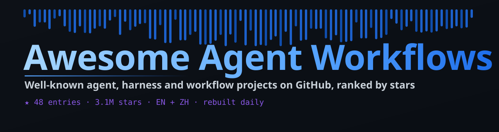
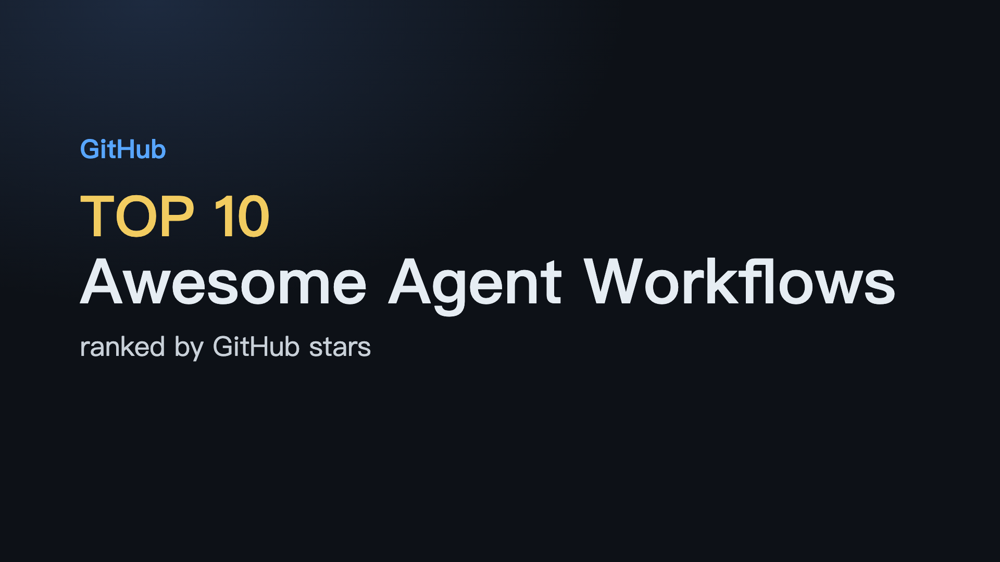
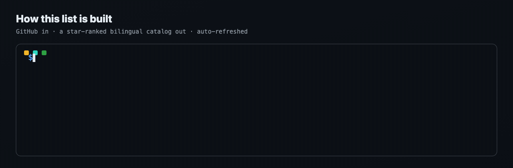

# Awesome Agent Workflows

<i>Well-known agent, harness and workflow projects on GitHub, ranked by stars</i>

  

  

**English** · [简体中文](README.zh-CN.md)

▶ Click the image to watch the demo video

 judge -> rank by stars -> render a bilingual list -> auto-refresh"/>

<a href="assets/how-it-works.html">▶ Interactive version (play/pause · scrub · step)</a>

---

## Contents

- [🏆 Top Picks](#top-picks)
- [Coding Agents & Harnesses](#sec-1) · 12
- [Agent Frameworks](#sec-2) · 12
- [Workflow Platforms](#sec-3) · 12
- [Patterns & Guides](#sec-4) · 12
- [📖 About this list](#about)

## 🏆 Top Picks

| # | Project | ⭐ Stars | Language | Updated | Description |
|:-:|:--|--:|:-:|:-:|:--|
| 1 | [**morluto/rea**](https://github.com/morluto/rea) | 451.1k | TypeScript | 2026-11-11 | Reverse engineer anything with agents, from app behavior down to native binaries. |
| 2 | [**affaan-m/ECC**](https://github.com/affaan-m/ECC) | 301.0k | JavaScript | 2026-11-09 | The agent harness performance optimization system. Skills, instincts, memory, security, and research-first de… |
| 3 | [**deepseek-ai/deepseek-harness**](https://github.com/deepseek-ai/deepseek-harness) | 278.6k | TypeScript | 2026-11-04 | DeepSeek Harness: Everything is a Plugin. |
| 4 | [**NousResearch/hermes-agent**](https://github.com/NousResearch/hermes-agent) | 262.6k | Python | 2026-11-11 | The agent that grows with you |
| 5 | [**langgenius/dify**](https://github.com/langgenius/dify) | 160.9k | Python | 2026-11-11 | Build Agentic workflows, RAG pipelines, with rich AI model and tool support on one collaborative workspace. D… |

## Coding Agents & Harnesses

| # | Project | ⭐ Stars | Language | Updated | Description |
|:-:|:--|--:|:-:|:-:|:--|
| 1 | [**morluto/rea**](https://github.com/morluto/rea) | 451.1k | TypeScript | 2026-11-11 | Reverse engineer anything with agents, from app behavior down to native binaries. |
| 2 | [**affaan-m/ECC**](https://github.com/affaan-m/ECC) | 301.0k | JavaScript | 2026-11-09 | The agent harness performance optimization system. Skills, instincts, memory, security, and research-first de… |
| 3 | [**NousResearch/hermes-agent**](https://github.com/NousResearch/hermes-agent) | 262.6k | Python | 2026-11-11 | The agent that grows with you |
| 4 | [**stablyai/orca**](https://github.com/stablyai/orca) | 121.8k | TypeScript | 2026-11-11 | Orca lets you run a fleet of coding agents (e.g. Claude Code, Codex) with your own subscription. Available on… |
| 5 | [**thedotmack/claude-mem**](https://github.com/thedotmack/claude-mem) | 116.0k | TypeScript | 2026-11-11 | Persistent Context Across Sessions for Every Agent – Captures everything your agent does during sessions, com… |
| 6 | [**paperclipai/paperclip**](https://github.com/paperclipai/paperclip) | 113.0k | TypeScript | 2026-11-11 | The open-source app everyone uses to manage agents at work |
| 7 | [**ruvnet/ruflo**](https://github.com/ruvnet/ruflo) | 81.5k | TypeScript | 2026-11-11 | 🌊 The original agent harness. Deploy intelligent multi-player swarms, coordinate autonomous workflows, and bu… |
| 8 | [**shareAI-lab/learn-claude-code**](https://github.com/shareAI-lab/learn-claude-code) | 80.3k | Python | 2026-10-27 | Bash is all you need - A nano claude code–like 「agent harness」, built from 0 to 1 |
| 9 | [**shanraisshan/claude-code-best-practice**](https://github.com/shanraisshan/claude-code-best-practice) | 69.0k | HTML | 2026-11-11 | from vibe coding to agentic engineering - practice makes claude perfect |
| 10 | [**openinterpreter/openinterpreter**](https://github.com/openinterpreter/openinterpreter) | 68.9k | Rust | 2026-11-11 | A coding agent for open models like Kimi K3 and GLM 5.3 |

Show 2 more

| # | Project | ⭐ Stars | Language | Updated | Description |
|:-:|:--|--:|:-:|:-:|:--|
| 11 | [**bojieli/ai-agent-book**](https://github.com/bojieli/ai-agent-book) | 57.7k | Python | 2026-10-08 | Chinese-language project; see the repo for details |
| 12 | [**codewhale-hq/Codewhale**](https://github.com/codewhale-hq/Codewhale) | 41.2k | Rust | 2026-11-11 | Open-source agent for the terminal written in Rust. Use any provider or model. Issues & PRs always welcome |

## Agent Frameworks

| # | Project | ⭐ Stars | Language | Updated | Description |
|:-:|:--|--:|:-:|:-:|:--|
| 1 | [**deepseek-ai/deepseek-harness**](https://github.com/deepseek-ai/deepseek-harness) | 278.6k | TypeScript | 2026-11-04 | DeepSeek Harness: Everything is a Plugin. |
| 2 | [**langchain-ai/langchain**](https://github.com/langchain-ai/langchain) | 149.3k | Python | 2026-11-11 | The agent engineering platform. |
| 3 | [**browser-use/browser-use**](https://github.com/browser-use/browser-use) | 120.7k | Python | 2026-11-11 | Open-source Python library for AI browser agents, plus Browser Use Cloud: stealth browsers and a hosted agent… |
| 4 | [**google-gemini/gemini-cli**](https://github.com/google-gemini/gemini-cli) | 108.8k | TypeScript | 2026-11-11 | An open-source AI agent that brings the power of Gemini directly into your terminal. |
| 5 | [**bytedance/deer-flow**](https://github.com/bytedance/deer-flow) | 85.2k | Python | 2026-11-11 | An open-source long-horizon SuperAgent harness that researches, codes, and creates. With the help of sandboxe… |
| 6 | [**microsoft/ai-agents-for-beginners**](https://github.com/microsoft/ai-agents-for-beginners) | 79.4k | Jupyter Notebook | 2026-11-07 | 18 Lessons to Get Started Building AI Agents |
| 7 | [**FoundationAgents/MetaGPT**](https://github.com/FoundationAgents/MetaGPT) | 71.2k | Python | 2026-01-21 | 🌟 The Multi-Agent Framework: First AI Software Company, Towards Natural Language Programming |
| 8 | [**code-yeongyu/oh-my-openagent**](https://github.com/code-yeongyu/oh-my-openagent) | 70.8k | TypeScript | 2026-11-11 | OmO: Just type "mass ulw" keyword with your prompt. Now you are the master of graph engineering. |
| 9 | [**HKUDS/nanobot**](https://github.com/HKUDS/nanobot) | 50.0k | Python | 2026-11-11 | Your lightweight open-source personal agent. |
| 10 | [**zhayujie/CowAgent**](https://github.com/zhayujie/CowAgent) | 47.9k | Python | 2026-11-10 | Open-source personal AI assistant & Agent Harness. Plans tasks, runs tools and skills, self-evolves with memo… |

Show 2 more

| # | Project | ⭐ Stars | Language | Updated | Description |
|:-:|:--|--:|:-:|:-:|:--|
| 11 | [**wshobson/agents**](https://github.com/wshobson/agents) | 42.4k | Python | 2026-11-09 | Plugins, agents, skills, and commands for Claude Code, Codex CLI, Cursor, OpenCode, Antigravity CLI, GitHub C… |
| 12 | [**HKUDS/Vibe-Trading**](https://github.com/HKUDS/Vibe-Trading) | 38.0k | Python | 2026-11-11 | "Vibe-Trading: Your Personal Trading Agent" |

## Workflow Platforms

| # | Project | ⭐ Stars | Language | Updated | Description |
|:-:|:--|--:|:-:|:-:|:--|
| 1 | [**langgenius/dify**](https://github.com/langgenius/dify) | 160.9k | Python | 2026-11-11 | Build Agentic workflows, RAG pipelines, with rich AI model and tool support on one collaborative workspace. D… |
| 2 | [**simstudioai/sim**](https://github.com/simstudioai/sim) | 30.1k | TypeScript | 2026-11-11 | Sim is the collaborative workspace to build, deploy, and monitor AI agents and workflows. Used by 100,000+ bu… |
| 3 | [**cft0808/edict**](https://github.com/cft0808/edict) | 17.1k | Python | 2026-09-28 | Chinese-language project; see the repo for details |
| 4 | [**The-Pocket/PocketFlow**](https://github.com/The-Pocket/PocketFlow) | 11.3k | Python | 2026-07-26 | Pocket Flow: 100-line LLM framework. Let Agents build Agents! |
| 5 | [**ykdojo/claude-code-tips**](https://github.com/ykdojo/claude-code-tips) | 10.3k | HTML | 2026-09-25 | 45+ tips for getting the most out of Claude Code, from basics to advanced - includes a custom status line scr… |
| 6 | [**iflytek/astron-agent**](https://github.com/iflytek/astron-agent) | 8.9k | Java | 2026-11-10 | Enterprise-grade, commercial-friendly agentic workflow platform for building next-generation SuperAgents. |
| 7 | [**JetBrains/thinkrail**](https://github.com/JetBrains/thinkrail) | 8.1k | TypeScript | 2026-11-11 | ThinkRail is the agentic IDE that gets better every time you use it |
| 8 | [**kyegomez/swarms**](https://github.com/kyegomez/swarms) | 7.4k | Python | 2026-11-11 | The Enterprise-Grade Multi-Agent Orchestration Framework. Website: https://swarms.ai |
| 9 | [**ModelEngine-Group/nexent**](https://github.com/ModelEngine-Group/nexent) | 6.2k | Python | 2026-11-11 | Nexent is a zero-code platform for auto-generating production-grade AI agents using Harness Engineering princ… |
| 10 | [**AhmadHassan-BTed/AutoSwarm-Shadow-Adapter**](https://github.com/AhmadHassan-BTed/AutoSwarm-Shadow-Adapter) | 5.2k | Python | 2026-11-09 | Zero-modification Human-in-the-Loop adapter for OpenOPC's agentic DAG runtime. |

Show 2 more

| # | Project | ⭐ Stars | Language | Updated | Description |
|:-:|:--|--:|:-:|:-:|:--|
| 11 | [**FellouAI/eko**](https://github.com/FellouAI/eko) | 5.0k | TypeScript | 2026-03-03 | Eko (Eko Keeps Operating) - Build Production-ready Agentic Workflow with Natural Language - eko.fellou.ai |
| 12 | [**KhazP/vibe-coding-prompt-template**](https://github.com/KhazP/vibe-coding-prompt-template) | 3.2k | TypeScript | 2026-10-04 | Templates and workflow for generating PRDs, Tech Designs, and MVP and more using LLMs for AI IDEs |

## Patterns & Guides

| # | Project | ⭐ Stars | Language | Updated | Description |
|:-:|:--|--:|:-:|:-:|:--|
| 1 | [**cobusgreyling/loop-engineering**](https://github.com/cobusgreyling/loop-engineering) | 11.7k | TypeScript | 2026-11-11 | Practical patterns, starters & CLI tools for loop engineering with AI coding agents. Design systems that prom… |
| 2 | [**xindoo/agentic-design-patterns**](https://github.com/xindoo/agentic-design-patterns) | 8.5k | HTML | 2026-08-30 | Chinese-language project; see the repo for details |
| 3 | [**panaversity/learn-agentic-ai**](https://github.com/panaversity/learn-agentic-ai) | 4.4k | Jupyter Notebook | 2025-10-26 | Learn Agentic AI using Dapr Agentic Cloud Ascent (DACA) Design Pattern and Agent-Native Cloud Technologies: O… |
| 4 | [**evoiz/Agentic-Design-Patterns**](https://github.com/evoiz/Agentic-Design-Patterns) | 4.1k | Jupyter Notebook | 2026-07-24 | — |
| 5 | [**Mathews-Tom/Agentic-Design-Patterns**](https://github.com/Mathews-Tom/Agentic-Design-Patterns) | 1.9k | — | 2025-09-05 | Agentic Design Patterns |
| 6 | [**6551Team/claude-code-design-guide**](https://github.com/6551Team/claude-code-design-guide) | 882 | JavaScript | 2026-04-15 | From Early Internet Design Patterns to AI Agent Implementation — A Deep Dive into Claude Code for Developers |
| 7 | [**microsoft/agenticai-design-patterns**](https://github.com/microsoft/agenticai-design-patterns) | 695 | Python | 2026-11-05 | — |
| 8 | [**fjb040911/ai-rules**](https://github.com/fjb040911/ai-rules) | 424 | JavaScript | 2026-10-10 | ai-rules is a governance framework designed to solve "Architectural Decay" in AI-driven development. It force… |
| 9 | [**fzy2012/rhzl-Agentic-Design-Patterns-cn**](https://github.com/fzy2012/rhzl-Agentic-Design-Patterns-cn) | 393 | Python | 2026-06-20 | Chinese-language project; see the repo for details |
| 10 | [**likaku/Mck-ppt-design-skill**](https://github.com/likaku/Mck-ppt-design-skill) | 337 | Python | 2026-11-03 | Chinese-language project; see the repo for details |

Show 2 more

| # | Project | ⭐ Stars | Language | Updated | Description |
|:-:|:--|--:|:-:|:-:|:--|
| 11 | [**huangjia2019/agent-design-patterns**](https://github.com/huangjia2019/agent-design-patterns) | 337 | HTML | 2026-10-11 | A 7×6 framework for agent architecture. 28 patterns, each placed at a coordinate, runnable Python code with v… |
| 12 | [**ningg/Agentic-Design-Patterns-CN**](https://github.com/ningg/Agentic-Design-Patterns-CN) | 329 | Python | 2026-08-17 | Chinese-language project; see the repo for details |

## 📖 About this list

This list is collected from GitHub, deduplicated, link-checked and ranked by stars (recency breaks ties). It is regenerated automatically on a schedule, so numbers stay fresh.

---

Auto-generated · refreshed on a schedule · ranked by GitHub stars · 2026-11-11

